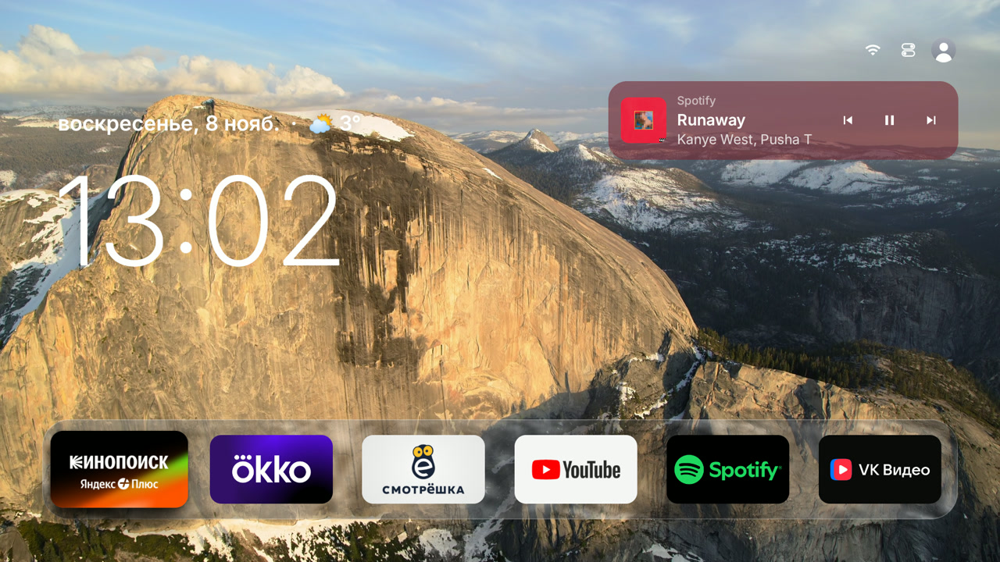
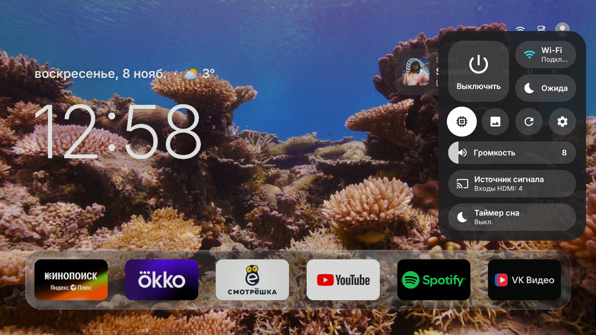
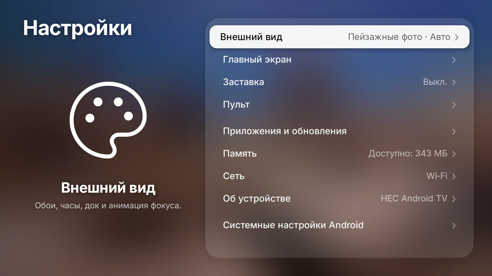

# Tigris RU — лаунчер для Android TV в стиле Apple TV

Минималистичный домашний экран для Android TV: живые подводные и городские пейзажи вместо обоев,
стеклянный док, «Сейчас играет» с текстом песни и звуки интерфейса. Русский интерфейс.
Сделан для слабых телевизоров с 1–1,5 ГБ памяти и при этом остаётся плавным.

Это форк [lesnolie/Tigris](https://github.com/lesnolie/Tigris) (MIT). Оригинальная документация:
[English](README.en.md) · [简体中文](README.zh.md).



| Пункт управления | Настройки |
|---|---|
|  |  |

## Что умеет

- **Живые обои.** Видеопейзажи Apple TV (Aerials) с аппаратным декодированием HEVC. Следующий ролик
  скачивается заранее, на диске занимают не больше 400 МБ. После возврата из приложения сразу виден
  последний кадр, и видео продолжается с того же места — без серого или чёрного экрана.
- **Стеклянный док** в духе Liquid Glass: стекло строится из кадра видео один раз, а не каждый кадр.
- **Сейчас играет.** Карточка с обложкой и кнопками ◀ ❚❚ ▶ для Spotify, YouTube Music и любого плеера
  с MediaSession.
- **Музыкальный режим.** Если музыка играет, а пульт минуту не трогали, открывается полноэкранная
  обложка с текстом песни, который идёт в такт (тексты — [LRCLIB](https://lrclib.net)).
- **Пункт управления** (кнопка «Назад» на главном экране): выключение, ожидание, громкость,
  источник сигнала, таймер сна.
- **Настройки** в 9 разделах, полупрозрачные, как в tvOS.
- **Погода** рядом с датой (Open-Meteo, запасной источник — MET Norway).
- **Переназначение кнопок пульта**: например, кнопка Netflix открывает Кинопоиск.
- **Звуки интерфейса** — свои файлы, см. ниже.
- **Самообновление**: новые версии приходят из
  [tigris-releases](https://github.com/artemtit/tigris-releases/releases). Лаунчер ставит только
  APK, подписанный тем же ключом.

Проверено на HEC Android TV: Android 11, Mali-470, 1,38 ГБ памяти. На других ТВ должно работать
(минимум Android 9), но не проверялось.

## Установка

Нужен компьютер с `adb` в той же сети, что и телевизор, и включённая отладка по сети на ТВ
(Настройки → Об устройстве → 7 раз нажать на «Сборка», затем включить отладку в «Для разработчиков»).

1. Скачайте `Tigris-vX.Y.Z.apk` из [последнего релиза](https://github.com/artemtit/tigris-releases/releases/latest).
2. Установите и сделайте домашним экраном:

   ```sh
   adb connect <ip-телевизора>:5555
   adb install -r Tigris-vX.Y.Z.apk
   adb shell cmd package set-home-activity com.leslie.tvhome/.HomeActivity
   adb shell input keyevent KEYCODE_HOME
   ```

Если на ТВ уже стоит оригинальный Tigris, сначала удалите его (`adb uninstall com.leslie.tvhome`):
у форка другая подпись, поверх он не встанет. Настройки оригинала при этом сбросятся.

Китайские прошивки (Xiaomi, TCL и другие), защита домашнего экрана, откат на заводской лаунчер —
всё это работает как в оригинале, подробности в [AGENTS.md](AGENTS.md) и [README.en.md](README.en.md).

## Звуки интерфейса

В APK звуков нет. Положите свои WAV-файлы в папку лаунчера на ТВ:

```sh
adb push navigate.wav click.wav back.wav /sdcard/Android/data/com.leslie.tvhome/files/sounds/
```

- `navigate.wav` — перемещение фокуса;
- `click.wav` — запуск приложения или настроек;
- `back.wav` — «Назад» и кнопка «Домой».

Каких-то файлов нет — этих звуков просто не будет. Включаются в Настройки → Внешний вид →
«Звуки интерфейса». Короткие звуки без тишины в начале звучат отзывчивее.

## Сборка из исходников

JDK 17 и Android SDK (platform 36):

```sh
./gradlew testStandardDebugUnitTest assembleStandardRelease
# APK: app/build/outputs/apk/standard/release/app-standard-release.apk
```

Своя сборка подписывается вашим ключом, поэтому самообновление из этого репозитория для неё
работать не будет — укажите свой репозиторий в `Updates.kt` и SHA-256 своего сертификата в
`UpdateSignerPolicy.TIGRIS_SIGNER`.

## Благодарности и лицензия

- [Tigris](https://github.com/lesnolie/Tigris) от lesnolie — основа лаунчера.
- Видеопейзажи принадлежат Apple и загружаются с серверов Apple; в репозитории и APK их нет.
- Тексты песен — [LRCLIB](https://lrclib.net), погода — [Open-Meteo](https://open-meteo.com) и
  [MET Norway](https://api.met.no).

Лицензия MIT, см. [LICENSE](LICENSE). Сторонние компоненты — в [THIRD_PARTY_NOTICES.md](THIRD_PARTY_NOTICES.md).
